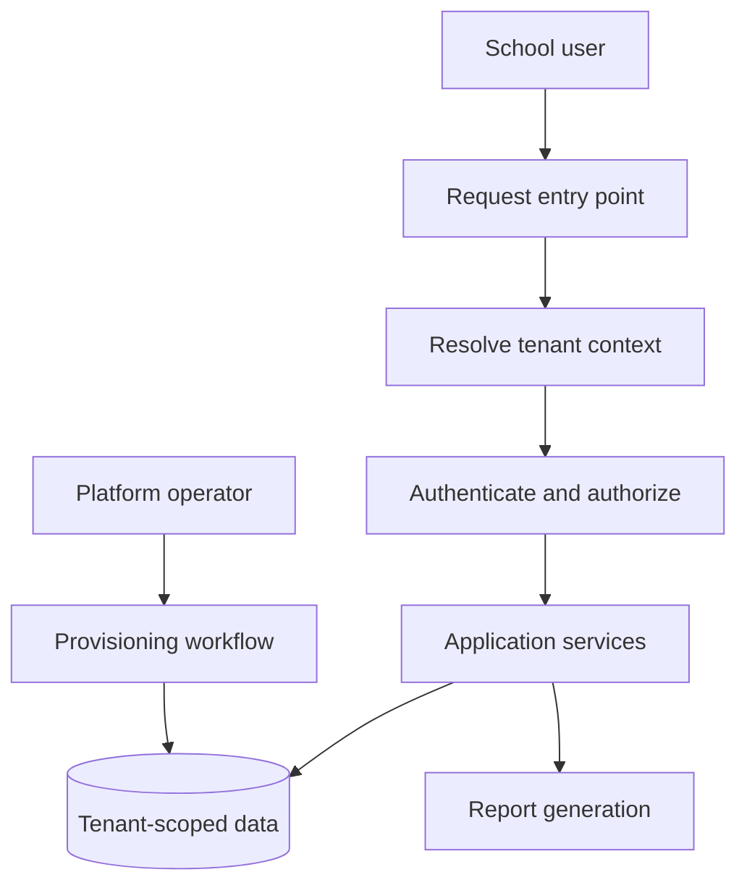

# EduPhix Engineering Showcase

A sanitized engineering case study presenting selected patterns for a multi-tenant school administration and reporting platform.

> This repository is an independent showcase. It is not the EduPhix application source code and is not intended to run the production service.

## Engineering areas

- **Multi-tenancy:** resolve a tenant from a trusted request context and scope data access to that tenant.
- **Authorization:** combine role checks with tenant membership checks.
- **Academic reporting:** demonstrate a transparent, configurable grade calculation.
- **Provisioning lifecycle:** model onboarding as explicit states rather than a single boolean.
- **Data protection:** use synthetic school and learner records throughout the examples.

## Architecture

## Repository map

- `docs/architecture.md` — tenant isolation, access control, and provisioning boundaries.
- `examples/tenant-context.ts` — tenant context and access guard.
- `examples/grade-calculation.ts` — configurable grade calculation with validation.
- `examples/provisioning.ts` — explicit school onboarding state machine.

## Key design decisions

1. Resolve tenant context from a verified hostname or authenticated membership, never from an untrusted tenant ID alone.
2. Include tenant scope in every data-access boundary.
3. Authorize both the user's role and their membership in the active tenant.
4. Keep grading rules explicit and versionable.
5. Treat provisioning as a recoverable workflow with observable states.

## Running the examples

The examples are dependency-free TypeScript snippets intended for a recent TypeScript project. They are reference implementations, not a complete application.

## Security and privacy

All school names, users, learner records, identifiers, and domain examples are synthetic. No production customer data, signatures, uploads, credentials, private endpoints, or production database definitions are included.

## About

EduPhix is a school administration and academic reporting platform. This repository presents selected engineering concepts while keeping the actual product implementation private.
